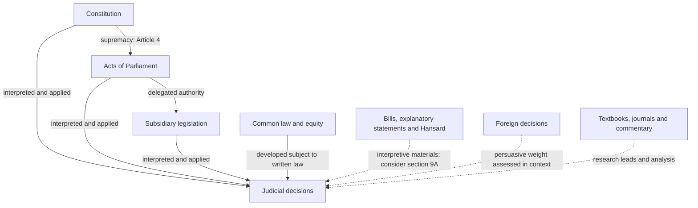
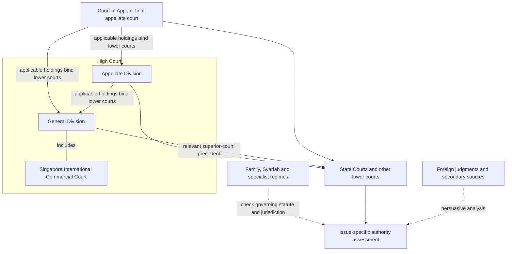
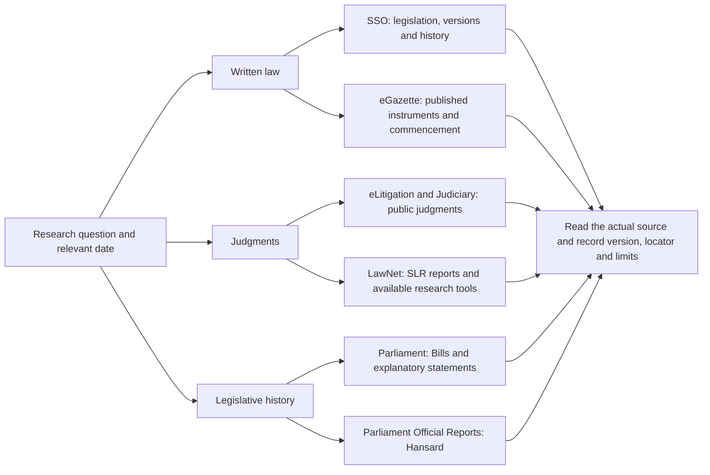
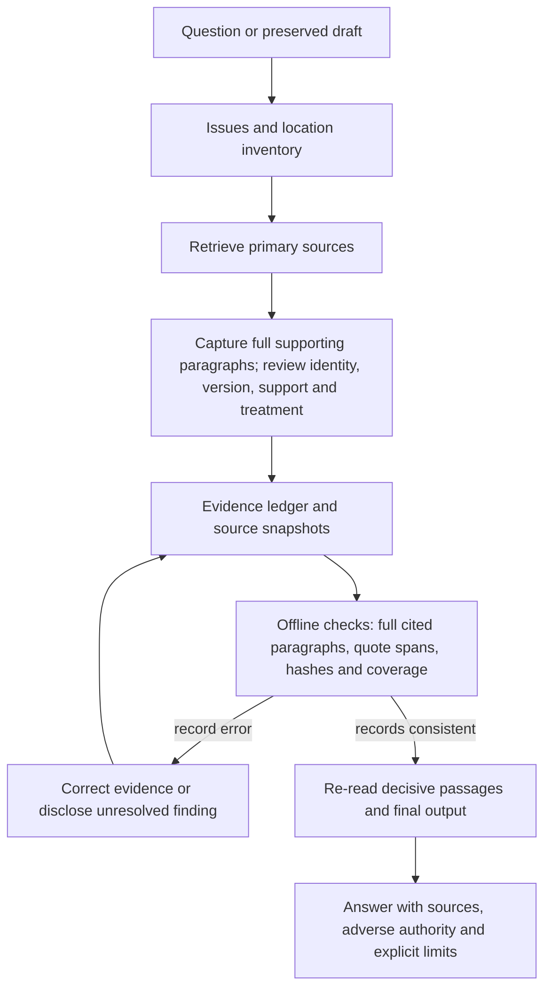
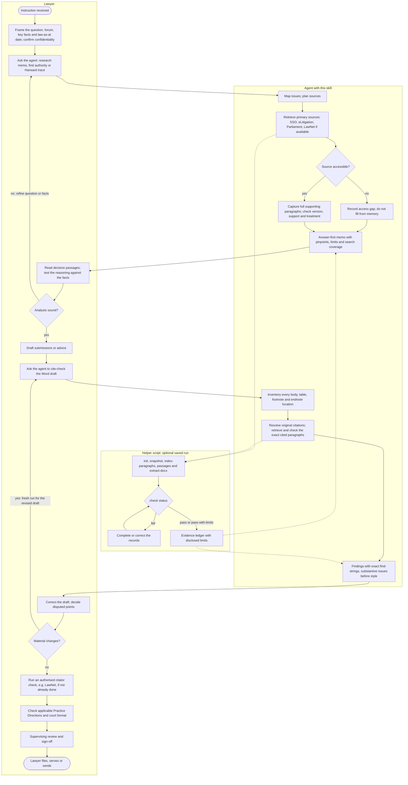

# Singapore Legal Research

A Singapore-specific legal research skill for Codex and Claude Code. Find authorities,
check a draft's citations, trace legislation and Hansard, and prepare research memos
with evidence the reader can inspect.

The skill combines legal research instructions with offline Python helpers. It uses
the research tools available in your agent session; it does not supply a legal database,
LawNet subscription, or automated citator.

## What you can ask

| Task | Example request | Result |
|---|---|---|
| Research memo | “Research the Singapore law on this issue as at 20 October 2026.” | Answer, analysis, supporting and adverse authorities, pinpoints, and gaps. |
| Deep research | “Investigate the competing interpretations and remedies.” | Issue matrix, primary-source analysis, contrary searches, and unresolved branches. |
| Find authority | “Find Singapore authority for this proposition.” | A small set of verified authorities, with the precise proposition each supports. |
| Cite-check | “Check every authority and quotation in this Word draft.” | Location-by-location findings, exact find-strings, verification status and coverage counts. |
| Statutes and Hansard | “Trace this section, its old numbering, and the relevant Second Reading debate.” | Version and commencement checks, provision mapping, legislative history and attributed speeches. |
| Proofread | “Proofread the prose and internal references.” | Specific editorial corrections that preserve legal effect. |
| Case preparation | “Prepare a case brief and authority index for this hearing.” | Issues, reasoning, disposition, later treatment, linked sources and missing documents. |
| Source library | “Build a Zotero-ready collection of the authorities used.” | Reviewed CSL-JSON records for import; no automatic live-library changes. |

## Sources of Singapore law

This map separates operative law from materials used to explain or interpret it.
The arrows describe legal relationships and research use; they do not decide any
particular validity or interpretation question.



Start with [Article 4 of the Constitution](https://sso.agc.gov.sg/Act/CONS1963?ProvIds=pr4-),
[Interpretation Act 1965, s 9A](https://sso.agc.gov.sg/Act/IA1965?ProvIds=pr9A-),
and the [Application of English Law Act 1993](https://sso.agc.gov.sg/Act/AELA1993)
where relevant. Hansard is an interpretive source, not enacted text. A foreign decision
does not become binding Singapore law because the legal terminology is familiar.
Treaties, custom, specialist jurisdictions and agency instruments require a separate
assessment of domestic legal effect; see the [authority reference](skills/singapore-legal-research/references/sources-authority.md).

## Stare decisis



This is a research-priority map, **not an appeal-route chart**. Civil appeals are
allocated by statute; not every case passes through the Appellate Division. SICC is
part of the General Division. Read the [Judiciary's description of Supreme Court
roles](https://www.judiciary.gov.sg/who-we-are/role-structure-supreme-court) and the
[Supreme Court of Judicature Act 1969](https://sso.agc.gov.sg/Act/SCJA1969).
For precedent, examine the holding, posture and subsequent treatment. Do not treat
every sentence of a higher-court decision as binding or assume coordinate judges
always bind one another.

## Where the skill researches



| Source | Role |
|---|---|
| [Singapore Statutes Online](https://sso.agc.gov.sg/) | AGC's legislation research service; select the relevant version and check publication status. |
| [eGazette](https://www.egazette.gov.sg/) | Gazette instruments, including amendments and commencement notifications. |
| [eLitigation](https://www.elitigation.sg/gd) / [Judiciary](https://www.judiciary.gov.sg/judgments/judgments-case-summaries) | Public judgments; distinguish full reasons from summaries. |
| [LawNet](https://www.lawnet.com/) | SLR/SLR(R) and subscription research resources where authorised access exists. |
| [Parliament Official Reports](https://www.parliament.gov.sg/parliamentary-business/official-reports-(parl-debates)) / [SPRS](https://sprs.parl.gov.sg/search/) | Speeches and debates with sitting, speaker and locator information. |
| [Parliament Bills](https://www.parliament.gov.sg/parliamentary-business/bills-introduced) | Bills and explanatory statements matched to the correct enactment. |

The [source directory](skills/singapore-legal-research/references/sources-authority.md)
also covers SAL publications, Singapore Law Watch and sector regulators. Search
snippets and commentary help find material; the underlying source supplies evidence.
Public judgment searches are not comprehensive citator checks.

## Statute citations have changed

The skill checks current AGC guidance alongside the 2021 SLR style guide and the 2007
SAL quick reference. Those guides are not bundled; the skill records their section
references and file fingerprints, and links public reading copies. Modern short titles include the relevant year. A current reference such as
`Interpretation Act 1965 s 9A` differs from an edition-specific SLR-style reference,
`Interpretation Act 1965 (2020 Rev Ed) s 9A`, and from a historical chapter citation.

It checks old/new provision mappings, commencement, later amendments, and the individual
instrument's revised edition. It does not assume `(2020 Rev Ed)` applies to every Act
or to subsidiary legislation. See the [statute protocol](skills/singapore-legal-research/references/statutes-revised-editions.md)
and [AGC's revised-edition guidance](https://www.agc.gov.sg/our-roles/drafter-of-laws/revised-editions-of-legislation/).

For cases, the [citation reference](skills/singapore-legal-research/references/citations.md)
distinguishes SLR/SLR(R), neutral citations and paragraph pinpoints. Quotations must be
checked against the version cited. Court work must also follow the [applicable Practice
Directions](https://www.judiciary.gov.sg/news-and-resources/practice-directions/supreme-court-practice-directions).
The reference PDFs are not redistributed; their titles, sections and fingerprints are documented.

## Install

Requirements: a skill-capable agent, Python **3.11+** for the optional helpers, and live
research access for current external verification. The helpers use only the Python
standard library. No API keys are required by this package.

Clone the repository, then install the skill for the runtime you use:

```sh
git clone https://github.com/kevanwee/sg-legalresearch.git
cd sg-legalresearch
python scripts/install_skill.py --target codex
# Or: python scripts/install_skill.py --target claude
```

The installer copies the self-contained skill to `~/.agents/skills/` for Codex or
`~/.claude/skills/` for Claude Code and refuses to overwrite an existing installation.
For an isolated project installation, supply `--skills-dir PATH_TO_PROJECT/.agents/skills`
(or `.claude/skills`). It does not change global settings or install tools.

Open a new agent session and ask naturally, or invoke `$singapore-legal-research` in
Codex / `/singapore-legal-research` in Claude Code. Installation paths follow the
[official OpenAI skills documentation](https://learn.chatgpt.com/docs/build-skills)
and [Claude Code skills documentation](https://code.claude.com/docs/en/skills).

To update, pull the repository and replace the installed copy after reviewing your
local changes. To uninstall, remove only the installed `singapore-legal-research` folder.
You can instead copy `skills/singapore-legal-research/` manually to the appropriate
skills directory. Do not install duplicate copies under several discovery roots.

## How verification works



The Python helper can preserve source bytes, extract Word paragraphs and notes, index
judgment paragraph labels, pull full cited paragraphs, bind quotations to those
paragraphs, detect changed snapshots and missing draft locations, and
export reviewed CSL-JSON records. The agent must identify individual citations, read
the sources, assess support, and check subsequent treatment. A passing check is **not**
a finding that the law is correct, complete, current or suitable for filing.

For example, initialise a private saved cite-check run (substitute the actual question and dates):

```sh
python skills/singapore-legal-research/scripts/research.py init runs/example --mode cite-check --question "Cite-check the draft submissions" --research-date 2026-10-20 --law-as-at 2026-10-20
python skills/singapore-legal-research/scripts/research.py extract-docx runs/example path/to/draft.docx
python skills/singapore-legal-research/scripts/research.py check runs/example
```

The last command deliberately fails until the evidence and review records are complete.
Full commands, JSON fields, quotation offsets, and check status meanings are in the
[evidence protocol](skills/singapore-legal-research/references/evidence-protocol.md).
Store actual research outside this public repository where practical. `runs/`, local
working material, PDFs, Word documents and environment files are ignored as a safeguard.
Ignoring a file does not remove it if someone has already committed it.

### Paragraph-level research and cite-checking

For case-law research, the skill retrieves the **complete supporting paragraph(s)**
even when the answer paraphrases the law. Citations include the verified case name
and report/neutral citation followed by `at [35]`, `at [35]–[37]`, or explicit disjoint
pinpoints. Full paragraphs stay in the private evidence record; the answer can give
a concise explanation or extract. Every paragraph in a cited range must be read.

Cite-checking works in the other direction: preserve the citation exactly as drafted,
retrieve **its specified paragraphs**, and compare their content with the proposition
or quotation. If support appears elsewhere, report the wrong pinpoint and retain the
original and proposed replacement passages separately. Finding a phrase somewhere
else in the judgment cannot pass the original citation.

After snapshotting a judgment's text, the helpers can capture the evidence:

```sh
python skills/singapore-legal-research/scripts/research.py index-paragraphs runs/example --source S1 --style bracketed --confirm-boundaries --review-note "Checked numbering and complete boundaries against the judgment"
python skills/singapore-legal-research/scripts/research.py passages runs/example --source S1 --pinpoint "[35]-[37]"
```

These commands assume source `S1` exists and those paragraph labels are in its saved
text. The second command returns complete paragraph text, offsets, source version and
the pinpointed citation; legal support still requires review. Older reports without
numbered paragraphs use documented page locators. Statutes and Hansard retain their
actual provision/column/page locators. See [paragraph evidence](skills/singapore-legal-research/references/paragraph-evidence.md)
for the workflow, original-citation findings, source-format limits and migration of
earlier saved runs.

## How a lawyer uses it

This process model shows one practitioner preparing written submissions. The lanes
show who is responsible for each step. The agent researches and checks the work, and
the lawyer keeps professional responsibility for the advice, the citations and the filing.



| Hand-off | What the lawyer receives | What it does **not** settle |
|---|---|---|
| Research memo | Answer, pinpointed authorities, adverse authority, search log, gaps | Whether the advice suits the client's full facts and strategy |
| Cite-check findings | Every draft location accounted for; exact find-strings and proposed corrections | Proposed replacements remain unverified until their sources are checked |
| `check` pass | Records are complete, internally consistent and hash-matched | Legal correctness, completeness, current law, or citator status |
| Public treatment search | Later decisions actually found and read | A comprehensive citator check; run an authorised one before relying on a case |

The skill never files, serves, uploads or sends material on its own initiative. A
revised draft needs a fresh run because each saved run keeps its draft snapshot fixed.

## Development and validation

```sh
python -m unittest discover -s tests -v
python scripts/validate_repository.py
```

Tests use synthetic documents and sources, not client material. CI runs on Linux and
Windows with Python 3.11 and 3.13. See [validation scope and behavioural scenarios](docs/validation.md)
for what is automated and what still requires a real research review. This is an
initial release; offline tests do not demonstrate comprehensive legal-research accuracy.

The [skill entry point](skills/singapore-legal-research/SKILL.md) routes to focused
references for [workflows](skills/singapore-legal-research/references/workflows.md),
[sources](skills/singapore-legal-research/references/sources-authority.md),
[statutes](skills/singapore-legal-research/references/statutes-revised-editions.md),
[Hansard](skills/singapore-legal-research/references/legislation-hansard.md),
[citations](skills/singapore-legal-research/references/citations.md), and
[evidence](skills/singapore-legal-research/references/evidence-protocol.md).
The [paragraph-evidence protocol](skills/singapore-legal-research/references/paragraph-evidence.md)
binds case-law support and cite-check findings to the actual cited passages.
Source and citation guidance was checked on **20 October 2026**; refresh it when used.

## Contributions and licence

For a research-rule change, include the official source, relevant provision or paragraph,
version date, and a scenario showing why the change matters. For a helper change, add
a meaningful regression test. Do not submit confidential facts, credentials or publisher
PDFs in issues or pull requests. Report access gaps separately from legal errors.

Original code and documentation are [MIT licensed](LICENSE). External legislation,
judgments, reports and style guides remain subject to their own terms. This project is
not affiliated with or endorsed by the Singapore Judiciary, AGC, Parliament, SAL or LawNet.
