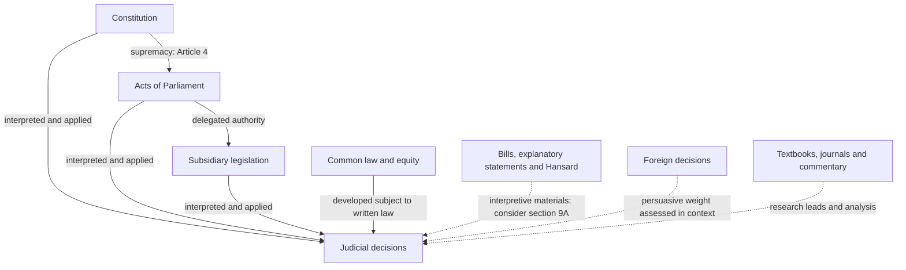
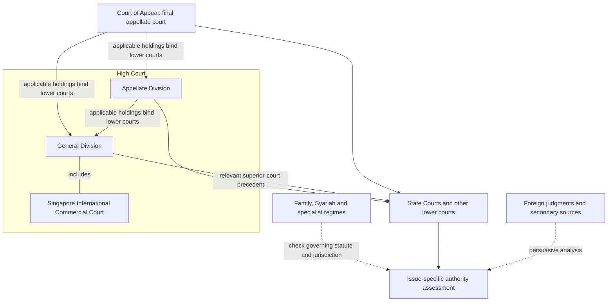
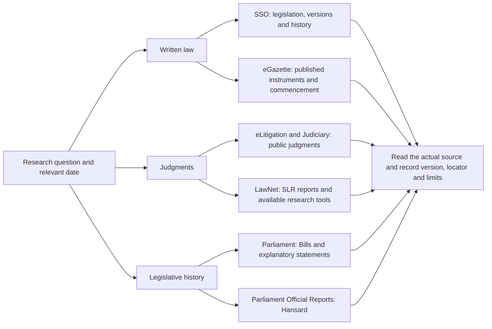
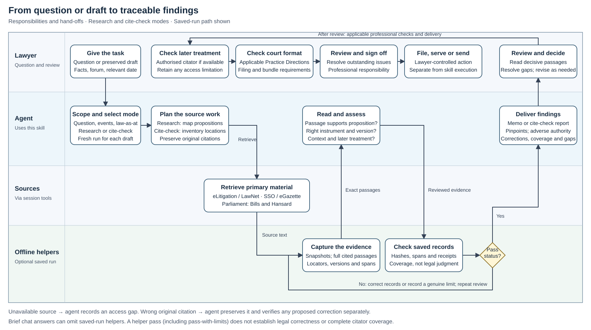

# Singapore Legal Research Skill

A Singapore-specific legal research skill for Codex and Claude Code. Find authorities,
check a draft's citations, trace legislation and Hansard, and prepare research memos
with evidence the reader can inspect.

[Install](#install) · [How it works](#how-the-skill-works) · [Release review](docs/release-v0.1.0.md)

The skill combines legal research instructions with offline Python helpers. It uses
the research tools available in your agent session; it does not supply a legal database,
LawNet subscription, or automated citator.

## What you can ask

| Task | Example request | Result |
|---|---|---|
| Research memo | “Research the Singapore law on this issue as at 20 October 2026.” | Answer, analysis, supporting and adverse authorities, pinpoints, and gaps. |
| Deep research | “Investigate the competing interpretations and remedies.” | Issue matrix, primary-source analysis, contrary searches, and unresolved branches. |
| Find authority | “Find Singapore authority for this proposition.” | A small set of verified authorities, with the precise proposition each supports. |
| Cite-check | “Check every authority and quotation in this Word draft.” | Location-by-location findings, exact find-strings, verification status and coverage counts. |
| Statutes and Hansard | “Trace this section, its old numbering, and the relevant Second Reading debate.” | Version and commencement checks, provision mapping, legislative history and attributed speeches. |
| Proofread | “Proofread the prose and internal references.” | Specific editorial corrections that preserve legal effect. |
| Case preparation | “Prepare a case brief and authority index for this hearing.” | Issues, reasoning, disposition, later treatment, linked sources and missing documents. |
| Source library | “Build a Zotero-ready collection of the authorities used.” | Reviewed CSL-JSON records for import; no automatic live-library changes. |

## Sources of Singapore law

This map separates operative law from materials used to explain or interpret it.
The arrows describe legal relationships and research use; they do not decide any
particular validity or interpretation question.



Start with [Article 4 of the Constitution](https://sso.agc.gov.sg/Act/CONS1963?ProvIds=pr4-),
[Interpretation Act 1965, s 9A](https://sso.agc.gov.sg/Act/IA1965?ProvIds=pr9A-),
and the [Application of English Law Act 1993](https://sso.agc.gov.sg/Act/AELA1993)
where relevant. Hansard is an interpretive source, not enacted text. A foreign decision
does not become binding Singapore law because the legal terminology is familiar.
Treaties, custom, specialist jurisdictions and agency instruments require a separate
assessment of domestic legal effect; see the [authority reference](skills/singapore-legal-research/references/sources-authority.md).

## Stare decisis



This is a research-priority map, **not an appeal-route chart**. Civil appeals are
allocated by statute; not every case passes through the Appellate Division. SICC is
part of the General Division. Read the [Judiciary's description of Supreme Court
roles](https://www.judiciary.gov.sg/who-we-are/role-structure-supreme-court) and the
[Supreme Court of Judicature Act 1969](https://sso.agc.gov.sg/Act/SCJA1969).
For precedent, examine the holding, posture and subsequent treatment. Do not treat
every sentence of a higher-court decision as binding or assume coordinate judges
always bind one another.

## Where the skill researches



| Source | Role |
|---|---|
| [Singapore Statutes Online](https://sso.agc.gov.sg/) | AGC's legislation research service; select the relevant version and check publication status. |
| [eGazette](https://www.egazette.gov.sg/) | Gazette instruments, including amendments and commencement notifications. |
| [eLitigation](https://www.elitigation.sg/gd) / [Judiciary](https://www.judiciary.gov.sg/judgments/judgments-case-summaries) | Public judgments; distinguish full reasons from summaries. |
| [LawNet](https://www.lawnet.com/) | SLR/SLR(R) and subscription research resources where authorised access exists. |
| [Parliament Official Reports](https://www.parliament.gov.sg/parliamentary-business/official-reports-(parl-debates)) / [SPRS](https://sprs.parl.gov.sg/search/) | Speeches and debates with sitting, speaker and locator information. |
| [Parliament Bills](https://www.parliament.gov.sg/parliamentary-business/bills-introduced) | Bills and explanatory statements matched to the correct enactment. |

The [source directory](skills/singapore-legal-research/references/sources-authority.md)
also covers SAL publications, Singapore Law Watch and sector regulators. Search
snippets and commentary help find material; the underlying source supplies evidence.
Public judgment searches are not comprehensive citator checks.

## Statute citations have changed

The skill checks current AGC guidance alongside the 2021 SLR style guide and the 2007
SAL quick reference. Those guides are not bundled; the skill records their section
references and file fingerprints, and links public reading copies. Modern short titles include the relevant year. A current reference such as
`Interpretation Act 1965 s 9A` differs from an edition-specific SLR-style reference,
`Interpretation Act 1965 (2020 Rev Ed) s 9A`, and from a historical chapter citation.

It checks old/new provision mappings, commencement, later amendments, and the individual
instrument's revised edition. It does not assume `(2020 Rev Ed)` applies to every Act
or to subsidiary legislation. See the [statute protocol](skills/singapore-legal-research/references/statutes-revised-editions.md)
and [AGC's revised-edition guidance](https://www.agc.gov.sg/our-roles/drafter-of-laws/revised-editions-of-legislation/).

For cases, the [citation reference](skills/singapore-legal-research/references/citations.md)
distinguishes SLR/SLR(R), neutral citations and paragraph pinpoints. Quotations must be
checked against the version cited. Court work must also follow the [applicable Practice
Directions](https://www.judiciary.gov.sg/news-and-resources/practice-directions/supreme-court-practice-directions).
The reference PDFs are not redistributed; their titles, sections and fingerprints are documented.

## Install

Use the **v0.1.0 release** for a pinned installation. These instructions are for
local Codex and Claude Code sessions with filesystem skill support.

### 1. Get the release

You need Git for the clone route and Python **3.11+** for the installer and optional
helpers. Check `python --version` first. On macOS/Linux, use `python3` if needed; on
Windows PowerShell, `py -3` is an alternative if it selects Python 3.11 or later.
No pip packages, API keys or global agent settings are required by this package.
Current external verification uses the research tools available in your agent session;
LawNet access requires your own authorised subscription where relevant.

```sh
git clone --branch v0.1.0 --depth 1 https://github.com/kevanwee/sg-legalresearch-skill.git
cd sg-legalresearch-skill
```

Without Git, download the **Source code (zip)** from the
[v0.1.0 release](https://github.com/kevanwee/sg-legalresearch-skill/releases/tag/v0.1.0),
extract it, and open a terminal in the extracted `sg-legalresearch-skill-0.1.0` folder
containing `README.md`, `scripts/` and `skills/`.

### 2. Install for your agent

For **Codex**, run:

```sh
python scripts/install_skill.py --target codex
```

For **Claude Code**, run:

```sh
python scripts/install_skill.py --target claude
```

Choose the agent you use; run both only if you want both installations. The installer
prints the destination and copies the entire self-contained skill, not just `SKILL.md`:

| Agent | Default installed folder |
|---|---|
| Codex | `~/.agents/skills/singapore-legal-research/` |
| Claude Code | `~/.claude/skills/singapore-legal-research/` |

`~` means your user home directory. For a project-only installation, replace
`PATH_TO_YOUR_PROJECT` with your actual project folder (quote paths with spaces):

```sh
python scripts/install_skill.py --target codex --skills-dir "PATH_TO_YOUR_PROJECT/.agents/skills"
# Claude Code uses:
python scripts/install_skill.py --target claude --skills-dir "PATH_TO_YOUR_PROJECT/.claude/skills"
```

The installer refuses to overwrite an existing installation. The supported discovery
locations are documented in the [official OpenAI skills documentation](https://learn.chatgpt.com/docs/build-skills)
and [Claude Code skills documentation](https://code.claude.com/docs/en/skills).
Personal-folder installation applies to local sessions; cloud sessions need the
skill installed in their own environment or committed to the project's discovery folder.

### 3. Confirm it works

Start a new agent session. Invoke `$singapore-legal-research` in Codex or
`/singapore-legal-research` in Claude Code, followed by a question, for example:

> Find Singapore authority for this proposition. Retrieve the complete supporting
> paragraphs, give pinpoint citations, and disclose any source or treatment gaps.

For a default Codex installation, this terminal command checks the installed helper:

```sh
python -I "$HOME/.agents/skills/singapore-legal-research/scripts/research.py" --help
```

For Claude Code, substitute `.claude` for `.agents`; for a project installation,
use the destination printed by the installer. `$HOME` works in PowerShell and common
macOS/Linux shells. The command should list `init`, `snapshot`, `index-paragraphs`,
`passages`, `index-provisions`, `provision`, `extract-docx`, `check` and `export-library`.
The helper also supports `-P` and `PYTHONSAFEPATH=1`.

If the skill does not appear, check that `SKILL.md`, `references/` and `scripts/` are
inside the installed `singapore-legal-research` folder, restart the session, and check
your agent's skill settings. Avoid duplicate copies in several discovery folders.
If `python` cannot be found, use the Python launcher described in step 1. An
"Installation already exists" message is intentional; follow the update steps below.

### Manual install, update and uninstall

For manual installation, copy the entire `skills/singapore-legal-research/` directory
to your agent's skills folder above. The release also includes a compact
`singapore-legal-research-v0.1.0.zip`: extract it and copy its
`singapore-legal-research/` folder to the same location. Do not copy the surrounding
repository folder or an extra nesting level. No installer is included in the compact
archive. `SHA256SUMS.txt` records its SHA-256 checksum.

To update, download the chosen newer release (or fetch tags and check out that tag in
your clone), review any local skill changes, and move the existing installed folder
to a backup **outside** all skill discovery folders. Run the installer again, or copy
the new skill folder into place, and start a new session. Pulling the repository alone
does not update the copied installation. A release-tag checkout is intentionally pinned.

To uninstall, remove only the installed `singapore-legal-research` folder and start a
new session. Private research runs are separate from the skill installation.

## How the skill works

The swimlanes show who performs each step and where work passes between the lawyer,
the agent using this skill, the available research sources and the optional offline
helpers. The source lane represents retrieval through the agent's session tools;
the bundled Python helpers do not browse legal databases.



[Open the full-size swimlane diagram](docs/diagrams/skill-workflow.svg). It shows the
saved-run path; a brief chat-only answer can retain the retrieved evidence in the
tool transcript instead.

Research starts with an issue map and retrieves the complete paragraphs or provisions
supporting each proposition. Cite-checking starts with the preserved draft and its
location inventory, then retrieves the exact passages specified by the original
citations. On each fresh draft, statutory checks establish the correct instrument
and the version applicable to the relevant events.

The agent reads those passages for support, context and later treatment. The helpers
capture evidence and check its recorded spans, hashes, version receipts and coverage.
Record errors return for correction and renewed review. Inaccessible material remains
an explicit gap; a wrong original citation stays a finding even when a separately
verified replacement is proposed. The lawyer receives the findings and sources for
review. A materially revised draft starts a fresh run.

The Python helper can preserve source bytes, extract Word paragraphs and notes, index
judgment paragraph labels, pull full cited paragraphs, bind quotations to those
paragraphs, detect changed snapshots and missing draft locations, and
export reviewed CSL-JSON records. The agent must identify individual citations, read
the sources, assess support, and check subsequent treatment. A passing check is **not**
a finding that the law is correct, complete, current or suitable for filing.

For example, initialise a private saved cite-check run (substitute the actual question and dates):

```sh
python skills/singapore-legal-research/scripts/research.py init runs/example --mode cite-check --question "Cite-check the draft submissions" --research-date 2026-10-20 --law-as-at 2026-10-20
python skills/singapore-legal-research/scripts/research.py extract-docx runs/example path/to/draft.docx
python skills/singapore-legal-research/scripts/research.py check runs/example
```

The last command deliberately fails until the evidence and review records are complete.
Full commands, JSON fields, quotation offsets, and check status meanings are in the
[evidence protocol](skills/singapore-legal-research/references/evidence-protocol.md).
Store actual research outside this public repository where practical. `runs/`, local
working material, PDFs, Word documents and environment files are ignored as a safeguard.
Ignoring a file does not remove it if someone has already committed it.

### Paragraph-level research and cite-checking

For case-law research, the skill retrieves the **complete supporting paragraph(s)**
even when the answer paraphrases the law. Citations include the verified case name
and report/neutral citation followed by `at [35]`, `at [35]–[37]`, or explicit disjoint
pinpoints. Full paragraphs stay in the private evidence record; the answer can give
a concise explanation or extract. Every paragraph in a cited range must be read.

Cite-checking works in the other direction: preserve the citation exactly as drafted,
retrieve **its specified paragraphs**, and compare their content with the proposition
or quotation. If support appears elsewhere, report the wrong pinpoint and retain the
original and proposed replacement passages separately. Finding a phrase somewhere
else in the judgment cannot pass the original citation.

After snapshotting a judgment's text, the helpers can capture the evidence:

```sh
python skills/singapore-legal-research/scripts/research.py index-paragraphs runs/example --source S1 --style bracketed --confirm-boundaries --review-note "Checked numbering and complete boundaries against the judgment"
python skills/singapore-legal-research/scripts/research.py passages runs/example --source S1 --pinpoint "[35]-[37]"
```

These commands assume source `S1` exists and those paragraph labels are in its saved
text. The second command returns complete paragraph text, offsets, source version and
the pinpointed citation; legal support still requires review. Older reports without
numbered paragraphs use documented page locators. Statutes and Hansard retain their
actual provision/column/page locators. See [paragraph evidence](skills/singapore-legal-research/references/paragraph-evidence.md)
for the workflow, original-citation findings, source-format limits and migration of
earlier saved runs.

The text indexer refuses numbering gaps, restarts and labels on their own lines,
instead of silently merging paragraphs. Split separately numbered opinions into
separate sources and prefer extraction that preserves the original source structure.
These checks catch ambiguity; they do not prove a conversion retained every paragraph.
Separate footnote/endnote headings and line-start note markers are refused too, so
recognisable trailing notes cannot become part of the last indexed paragraph. Keep
notes separately and document the source-structured body extraction.
Statutory numbering follows the explicit provision map below, without a consecutive-number rule.

### Statutory provisions and fresh-draft checks

Statutory citations receive three separate checks:

1. **Correct instrument:** match the draft's name or abbreviation to the precise title,
   year and identifier. Distinguish an Act from its subsidiary legislation, a similarly
   named instrument, a predecessor/re-enactment and an amending Act.
2. **Applicable version:** establish the relevant event date, then verify the specific
   provision's operative wording, commencement, amendments, savings and renumbering.
   The newest consolidation is not automatically the version governing the facts.
3. **Exact provision:** retain the complete cited section/subsection, rule, regulation
   or schedule unit, plus its enclosing context and relevant definitions/exceptions.
   Words elsewhere in the instrument do not verify the cited provision.

Each fresh or materially revised draft needs a new run and renewed identity/version
checks. Saved statutory verification records identify the actual instrument, selected
date and checks performed, and are tied to that run and draft snapshot. A receipt
from another run, research date or draft hash fails validation. Prior downloads can
help research; their earlier review status is not silently reused for a new document.

The helpers use a reviewed provision map of exact source spans and hierarchy:

```sh
python skills/singapore-legal-research/scripts/research.py index-provisions runs/example --source L1 --map provision-map.json --confirm-boundaries --review-note "Checked complete units against the selected official version"
python skills/singapore-legal-research/scripts/research.py provision runs/example --source L1 --locator "s 9A(2)(b)"
```

These commands require source `L1` and a completed map/verification record; they do
not infer legal hierarchy from arbitrary SSO/PDF formatting. Cite-check findings
distinguish **wrong instrument**, **wrong version** and **wrong provision**, preserving
the original citation and any separately verified proposed correction. See
[statutory evidence](skills/singapore-legal-research/references/statutory-evidence.md)
for map fields, version checks, precise locators and fresh-draft requirements.
Mapped spans that cut off before continuation text are refused; complete units must
end at a following unit boundary or the end of the saved source. This checks the
saved text, so a source file already truncated at its own end still needs comparison
with the original.

Parent lead-in words remain context when a child is cited: to verify a quotation from
the opening of `s 9A(2)`, cite and capture `s 9A(2)` itself. Definition-specific locators
such as `s 2(1) definition of "x"` are not parsed; capture the whole `s 2(1)` and identify
the definition in the analysis, or disclose a manual-verification limit. A `supported`
claim relying on a `repealed` or `not-in-force` unit needs an evidence `date_basis`
explaining its use; otherwise qualify the claim. The status remains a disclosed limit.

## What the lawyer receives

| Hand-off | What the lawyer receives | What it does **not** settle |
|---|---|---|
| Research memo | Answer, pinpointed authorities, adverse authority, search log, gaps | Whether the advice suits the client's full facts and strategy |
| Cite-check findings | Every draft location accounted for; exact find-strings and proposed corrections | Proposed replacements remain unverified until their sources are checked |
| `check` pass | Records are complete, internally consistent and hash-matched | Legal correctness, completeness, current law, or citator status |
| Public treatment search | Later decisions actually found and read | A comprehensive citator check; run an authorised one before relying on a case |

The skill never files, serves, uploads or sends material on its own initiative. A
revised draft needs a fresh run because each saved run keeps its draft snapshot fixed.
For advice or court work, the lawyer completes the applicable citator/treatment check,
Practice Directions and formatting checks, and professional sign-off before filing,
serving or sending. Any unavailable citator access remains an explicit research limit.

## Development and validation

```sh
python -m unittest discover -s tests -v
python scripts/validate_repository.py
```

Tests use synthetic documents and sources, not client material. CI runs on Linux and
Windows with Python 3.11 and 3.13. See [validation scope and behavioural scenarios](docs/validation.md)
for what is automated and what still requires a real research review. This is an
initial release; offline tests do not demonstrate comprehensive legal-research accuracy.

The [skill entry point](skills/singapore-legal-research/SKILL.md) routes to focused
references for [workflows](skills/singapore-legal-research/references/workflows.md),
[sources](skills/singapore-legal-research/references/sources-authority.md),
[statutes](skills/singapore-legal-research/references/statutes-revised-editions.md),
[Hansard](skills/singapore-legal-research/references/legislation-hansard.md),
[citations](skills/singapore-legal-research/references/citations.md), and
[evidence](skills/singapore-legal-research/references/evidence-protocol.md).
The [paragraph-evidence protocol](skills/singapore-legal-research/references/paragraph-evidence.md)
binds case-law support and cite-check findings to the actual cited passages.
The [statutory-evidence protocol](skills/singapore-legal-research/references/statutory-evidence.md)
does the same for provisions, instrument identity and versions in each fresh draft.
Source and citation guidance was checked on **20 October 2026**; refresh it when used.

## Contributions and licence

For a research-rule change, include the official source, relevant provision or paragraph,
version date, and a scenario showing why the change matters. For a helper change, add
a meaningful regression test. Do not submit confidential facts, credentials or publisher
PDFs in issues or pull requests. Report access gaps separately from legal errors.

Original code and documentation are [MIT licensed](LICENSE). External legislation,
judgments, reports and style guides remain subject to their own terms. This project is
not affiliated with or endorsed by the Singapore Judiciary, AGC, Parliament, SAL or LawNet.
